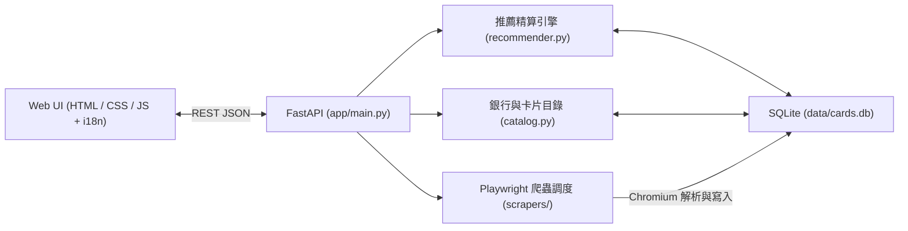

# 台灣信用卡回饋比較與常用通路推薦系統

使用 **Python + FastAPI + Playwright + SQLite** 打造的個人化台灣信用卡回饋試算與比較網站（支援 **繁體中文 / English** 雙語介面）。  
使用者只需輸入每月在「超商、餐飲、外送、網購、行動支付、超市量販、交通、旅遊、海外」等 10 大通路的消費金額，系統即可自動精算**低消門檻、每月回饋上限與切換方案最佳化**，產出**單卡排行**與**多卡分刷最佳組合**，並內建 Playwright 爬蟲中心以更新銀行信用卡規則與目錄。

---

## English Summary

### Purpose
A personalized **Taiwan Credit Card Rewards & Channel Recommender** built with **Python, FastAPI, Playwright, SQLite, and vanilla HTML/CSS/JS** (with **Traditional Chinese `zh-TW` & English `en` i18n**).  
Users enter monthly spending across 10 standardized Taiwan spending channels (convenience stores, dining, food delivery, online shopping, mobile payments, supermarkets, transit, travel, overseas, and general domestic), and the engine computes minimum-spend thresholds, monthly reward caps (with base-rate fallback on excess spend), switchable-plan optimization (e.g., Cathay CUBE), single-card rankings, and an optimal multi-card combo. It also includes a Playwright scraper console to refresh card rules and discover cards from 21 Taiwan issuing banks.

### Test Scope
Automated tests under `tests/` (`22` test cases) cover:
- **Recommendation Engine (`tests/test_recommender.py`)**: Switchable-plan optimization, monthly reward caps & excess base-rate fallback, truncated condition note flagging (`note_truncated`), minimum-spend threshold filtering (`only_no_min_spend`), and multi-card combo vs. best single card.
- **FastAPI Endpoints & Catalog (`tests/test_api.py`)**: Health/config/channels/cards/banks endpoints, spending validation bounds (`0`–`9,999,999` NTD), bank card directory merging, discontinued card exclusion, `ADMIN_TOKEN` / `PUBLIC_READONLY` access guards, and full-width/variant query normalization.
- **Playwright Scraper & Parsers (`tests/test_scraper_parser.py`)**: Percentage & monthly cap extraction (filtering out APR disclosures, ETF/deposit promos, service fees, dates, and `"無上限"` false positives), channel/payment detection, `demo_html` Chromium scraping, custom scraper helpers, and discontinued page detection.
- **Internationalization (`tests/test_i18n.py`)**: Bilingual `zh-TW` & `en` responses across `/api/channels`, `/api/cards`, `/api/recommend`, `/api/banks`, `/api/scrapers`, `/api/scrape/custom`, `/api/scrape-logs`, and localized `403` admin error messages.

### How to Run

1. **Install dependencies & Playwright Chromium**
   ```bash
   python3 -m venv .venv
   source .venv/bin/activate
   pip install -r requirements-dev.txt
   playwright install chromium
   ```
2. **Start the local web server**
   ```bash
   .venv/bin/uvicorn app.main:app --reload --port 8000
   ```
   Open `http://127.0.0.1:8000` (or `http://127.0.0.1:8000/?lang=en` for English) and `http://127.0.0.1:8000/docs` for Swagger API docs.
3. **Run the test suite**
   ```bash
   .venv/bin/pytest -v
   ```
4. **Optional Docker Compose setup**
   ```bash
   cp .env.example .env
   # Edit .env to set your own ADMIN_TOKEN if exposing publicly
   docker compose up -d --build
   ```

---

## 核心功能與技術亮點

- **個人化回饋精算與多卡組合引擎（[recommender.py](app/recommender.py)）**
  - 支援 10 大標準化台灣消費通路（[channels.py](app/channels.py)）及一鍵情境範本（小資外食網購族、日本旅遊高消費族、通勤超商日常族），單一通路輸入上限為 7 位數（`NT$ 9,999,999`）。
  - 自動計算最低消費門檻、每月回饋上限（超過上限部分改計基本回饋率），以及權益切換型信用卡（如國泰 CUBE 卡）之最佳方案自動試算。
  - 提供「無低消門檻」篩選，並計算「最佳多卡分刷組合」相較最佳單卡的額外省錢金額；過長或截斷的條件說明後方提供 `more` 來源超連結直達銀行官網。
- **多語系 i18n 支援（[i18n.py](app/i18n.py)、[static/i18n.js](static/i18n.js)）**
  - 支援頁首即時切換 **繁中 / EN**（亦可透過 `/?lang=en` 進入），同時本地化前端介面、通路名稱、銀行／卡片名稱、試算明細與爬蟲紀錄。
- **Playwright 銀行爬蟲與卡片目錄系統（[scrapers/](app/scrapers/)、[catalog.py](app/catalog.py)）**
  - **銀行專屬爬蟲**：內建國泰、玉山、台新示範與即時官網解析，支援離線 `demo_html` 測試與 `live` 爬取兩種模式。
  - **台灣發卡行連動選單與自訂爬取**：收錄 21 家台灣主要發卡銀行與實測有效的熱門卡介紹頁網址，支援透過 Playwright 從銀行官網總覽頁擷取更多卡片並合併至資料庫目錄。
  - **資料品質與防護機制**：過濾停發／停止申辦卡片、循環利率／手續費／服務費等非回饋資訊與異常百分比、非卡片導覽／服務頁連結（如掛失、登入、辦卡頁），正規化全形與異體字（`NFKC`、`滙/匯`）以避免重複收錄，並檢查自訂網址避免存取內部位址。
- **資料持久化與更新標注（[db.py](app/db.py)、[static/](static/)）**
  - 以 SQLite 保存信用卡規則、官網擷取卡片目錄與 `scrape_logs` 執行紀錄。
  - 推薦結果、通路比較表與爬蟲中心皆顯示每張卡最新資料的更新日期（台灣時間）。

---

## 系統架構



---

## 專案目錄結構

```text
credit_card_recommend/
├── app/
│   ├── main.py              # FastAPI 應用入口與 API 路由
│   ├── models.py            # Pydantic 請求與回應資料模型
│   ├── channels.py          # 台灣 10 大常用消費通路定義
│   ├── i18n.py              # 後端繁體中文 / 英語多語系翻譯模組
│   ├── db.py                # SQLite 資料表初始化與讀寫
│   ├── seed_data.py         # 開箱即用之台灣熱門信用卡預設規則庫
│   ├── recommender.py       # 單卡評分、方案切換最佳化與多卡分刷組合演算法
│   ├── catalog.py           # 台灣發卡行目錄、官網卡名擷取與有效卡片過濾
│   └── scrapers/
│       ├── base.py          # Playwright 共用基底、中文規則解析與停發偵測
│       ├── manager.py       # 預設銀行爬蟲調度器（live / demo_html）
│       ├── custom.py        # 依自訂卡名／網址定位並爬取解析模組
│       └── banks/           # 各銀行專用爬蟲（國泰、玉山、台新）
├── static/                  # 原生前端介面（index.html / styles.css / i18n.js / app.js）
├── tests/                   # 推薦引擎、API、i18n 與 Playwright 解析自動化測試
├── Dockerfile               # 含 Playwright Chromium 的容器部署設定
├── render.yaml              # Render 雲端一鍵部署設定檔
└── requirements.txt
```

---

## 本機安裝與啟動

### 1. 建立虛擬環境並安裝套件

```bash
python3 -m venv .venv
source .venv/bin/activate
pip install -r requirements.txt
playwright install chromium
```

### 2. 啟動服務

```bash
.venv/bin/uvicorn app.main:app --reload --port 8000
```

啟動後於瀏覽器開啟：
- **網站主畫面**：`http://127.0.0.1:8000`（英文版：`http://127.0.0.1:8000/?lang=en`）
- **API 互動文件（Swagger UI）**：`http://127.0.0.1:8000/docs`

### 3. 執行自動化測試

```bash
.venv/bin/pytest -v
```

測試涵蓋：
- 推薦引擎（方案切換最佳化、月回饋上限與超額基本回饋、截斷條件 `note_truncated` 標記、低消門檻過濾、多卡組合效益）
- FastAPI 端點、消費輸入上下限驗證與台灣銀行／卡片目錄過濾
- 多語系 i18n（繁中／英語端點轉換、英語自訂爬取對照、歷史 `scrape_logs` 翻譯、語系錯誤訊息）
- Playwright 離線 HTML 解析、非回饋字詞過濾、通用頁面解析與停發卡偵測

---

## Docker 與雲端部署（Live Demo）

本專案已提供 [Dockerfile](Dockerfile) 與 [render.yaml](render.yaml)，可直接部署至支援 Docker 的雲端平台（如 **Render**、**Zeabur**、**Railway**、**Fly.io**）：

### 本機使用 Docker Compose 啟動（自架主機推薦）

```bash
cp .env.example .env
# 編輯 .env 設定你的 ADMIN_TOKEN（管理員密碼），再啟動容器
docker compose up -d --build
```

- 預設僅綁定 `127.0.0.1:8000` 並自動掛載 `./data:/app/data` 保留 SQLite 資料庫，搭配 **Cloudflare Tunnel** 對外綁定固定網域即可兼顧安全與持久化。
- Playwright 爬蟲內建單一併發鎖（同一時間最多執行 1 個無頭瀏覽器任務），並支援 `ADMIN_TOKEN` 與 `PUBLIC_READONLY` 防護避免公開網站遭濫用。

### 部署至 Render（免費方案）
1. 登入 [Render](https://render.com/)，選擇 **New + → Blueprint**（或 **Web Service**）。
2. 連接此 GitHub Repository（`credit_card_recommend`）。
3. Render 會自動偵測 `render.yaml` 與 `Dockerfile` 並執行建置與健康檢查（`/api/health`）。

> **雲端 Demo 環境提醒**：免費方案容器記憶體較小且閒置會休眠，推薦試算、比較表與 `demo_html` 示範爬蟲可穩定運行；即時爬取銀行官網（`live`）在部分雲端機房 IP 可能受銀行防爬蟲策略或連線逾時限制。各家銀行信用卡權益與回饋上限請以發卡銀行最新官方公告為準。
