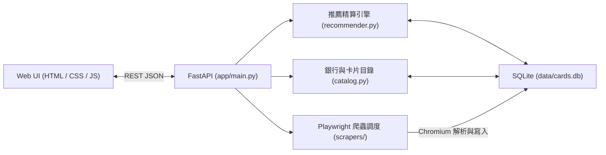

# 台灣信用卡回饋比較與常用通路推薦系統

使用 **Python + FastAPI + Playwright + SQLite** 打造的個人化台灣信用卡回饋試算與比較網站。  
使用者只需輸入每月在「超商、餐飲、外送、網購、行動支付、超市量販、交通、旅遊、海外」等 10 大通路的消費金額，系統即可自動精算**低消門檻、每月回饋上限與切換方案最佳化**，產出**單卡排行**與**多卡分刷最佳組合**，並內建 Playwright 爬蟲中心以更新銀行信用卡規則與目錄。

---

## 核心功能與技術亮點

- **個人化回饋精算與多卡組合引擎（[recommender.py](app/recommender.py)）**
  - 支援 10 大標準化台灣消費通路（[channels.py](app/channels.py)）及一鍵情境範本（小資外食網購族、日本旅遊高消費族、通勤超商日常族）。
  - 自動計算最低消費門檻、每月回饋上限（超過上限部分改計基本回饋率），以及權益切換型信用卡（如國泰 CUBE 卡）之最佳方案自動試算。
  - 提供「無低消門檻」篩選，並計算「最佳多卡分刷組合」相較最佳單卡的額外省錢金額。
- **Playwright 銀行爬蟲與卡片目錄系統（[scrapers/](app/scrapers/)、[catalog.py](app/catalog.py)）**
  - **銀行專屬爬蟲**：內建國泰、玉山、台新示範與即時官網解析，支援離線 `demo_html` 測試與 `live` 爬取兩種模式。
  - **台灣發卡行連動選單與自訂爬取**：收錄 21 家台灣主要發卡銀行與實測有效的熱門卡介紹頁網址，支援透過 Playwright 從銀行官網總覽頁擷取更多卡片並合併至資料庫目錄。
  - **資料品質與防護機制**：過濾停發／停止申辦卡片、非卡片導覽／服務頁連結（如掛失、登入、辦卡頁），正規化全形與異體字（`NFKC`、`滙/匯`）以避免重複收錄，並檢查自訂網址避免存取內部位址。
- **資料持久化與更新標注（[db.py](app/db.py)、[static/](static/)）**
  - 以 SQLite 保存信用卡規則、官網擷取卡片目錄與 `scrape_logs` 執行紀錄。
  - 推薦結果、通路比較表與爬蟲中心皆顯示每張卡最新資料的更新日期（台灣時間）。

---

## 系統架構



---

## 專案目錄結構

```text
credit_card_recommend/
├── app/
│   ├── main.py              # FastAPI 應用入口與 API 路由
│   ├── models.py            # Pydantic 請求與回應資料模型
│   ├── channels.py          # 台灣 10 大常用消費通路定義
│   ├── db.py                # SQLite 資料表初始化與讀寫
│   ├── seed_data.py         # 開箱即用之台灣熱門信用卡預設規則庫
│   ├── recommender.py       # 單卡評分、方案切換最佳化與多卡分刷組合演算法
│   ├── catalog.py           # 台灣發卡行目錄、官網卡名擷取與有效卡片過濾
│   └── scrapers/
│       ├── base.py          # Playwright 共用基底、中文規則解析與停發偵測
│       ├── manager.py       # 預設銀行爬蟲調度器（live / demo_html）
│       ├── custom.py        # 依自訂卡名／網址定位並爬取解析模組
│       └── banks/           # 各銀行專用爬蟲（國泰、玉山、台新）
├── static/                  # 原生前端介面（index.html / styles.css / app.js）
├── tests/                   # 推薦引擎、API 端點與 Playwright 解析自動化測試
├── Dockerfile               # 含 Playwright Chromium 的容器部署設定
├── render.yaml              # Render 雲端一鍵部署設定檔
└── requirements.txt
```

---

## 本機安裝與啟動

### 1. 建立虛擬環境並安裝套件

```bash
python3 -m venv .venv
source .venv/bin/activate
pip install -r requirements.txt
playwright install chromium
```

### 2. 啟動服務

```bash
.venv/bin/uvicorn app.main:app --reload --port 8000
```

啟動後於瀏覽器開啟：
- **網站主畫面**：`http://127.0.0.1:8000`
- **API 互動文件（Swagger UI）**：`http://127.0.0.1:8000/docs`

### 3. 執行自動化測試

```bash
.venv/bin/pytest -v
```

測試涵蓋：
- 推薦引擎（方案切換最佳化、月回饋上限與超額基本回饋、低消門檻過濾、多卡組合效益）
- FastAPI 端點與台灣銀行／卡片目錄過濾
- Playwright 離線 HTML 解析、通用頁面解析與停發卡偵測

---

## Docker 與雲端部署（Live Demo）

本專案已提供 [Dockerfile](Dockerfile) 與 [render.yaml](render.yaml)，可直接部署至支援 Docker 的雲端平台（如 **Render**、**Zeabur**、**Railway**、**Fly.io**）：

### 本機使用 Docker 驗證

```bash
docker build -t credit-card-recommend .
docker run --rm -p 8000:8000 credit-card-recommend
```

### 部署至 Render（免費方案）
1. 登入 [Render](https://render.com/)，選擇 **New + → Blueprint**（或 **Web Service**）。
2. 連接此 GitHub Repository（`credit_card_recommend`）。
3. Render 會自動偵測 `render.yaml` 與 `Dockerfile` 並執行建置與健康檢查（`/api/health`）。

> **雲端 Demo 環境提醒**：免費方案容器記憶體較小且閒置會休眠，推薦試算、比較表與 `demo_html` 示範爬蟲可穩定運行；即時爬取銀行官網（`live`）在部分雲端機房 IP 可能受銀行防爬蟲策略或連線逾時限制。各家銀行信用卡權益與回饋上限請以發卡銀行最新官方公告為準。
